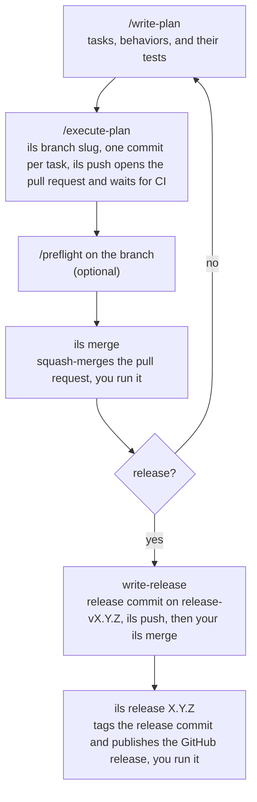

# Plan and release flow

How work moves from an approved plan to a tag on `main`, which command does each git write, and what
stops the assistant from doing any of it by hand. The assistant plans, implements, and pushes; you
merge each pull request with `ils merge` and tag each release with `ils release`.

**What this doc covers:** [the branches](#the-branches), [the loop](#the-loop),
[one plan, one pull request](#one-plan-one-pull-request), [releasing](#releasing),
[what enforces it](#what-enforces-it), and [recovering](#recovering).

**What this doc does not cover:** the plan template and task wording (`write-plan`), the task loop's
gates and reports (`execute-plan`), or the version-bump and changelog mechanics (`write-release`).
This doc covers only where each one writes to git.

## The branches

| Branch           | Who creates it                               | What lands on it                                            |
| ---------------- | -------------------------------------------- | ----------------------------------------------------------- |
| `main`           | —                                            | One squash commit per pull request, merged with `ils merge` |
| `<slug>`         | `/execute-plan`, through `ils branch <slug>` | One commit per task, findings fixes, CI fixes               |
| `release-vX.Y.Z` | `write-release`, through `ils branch`        | The release commit                                          |
| `fix-ci/<slug>`  | `/fix-ci`                                    | Attempts to make a red run green, squashed back when it is  |

Every branch but `fix-ci/*` lands on `main` as a pull request. The flow needs the
[`ils`](https://github.com/jeffzi/ils) binary 0.5.x on your `PATH`, and the `ils` skill linked at
`~/.claude/skills/ils` (a symlink into a clone of the ils repository; see `.gitignore`). This
repository installs neither.

## The loop

One change is one pass of this loop: `/write-plan`, `/execute-plan`, optionally `/preflight`, then
`ils merge`. A release is a pass with `write-release` in place of the plan, then `ils release`.

`ils status` answers "where are we" at any point: it says where the checkout stands and what to run
next.

## One plan, one pull request

`/execute-plan` works on its own branch, never on `main`. Started on `main`, it runs `ils branch
<slug>`, which starts `<slug>` from `main` as origin has it and switches to it. Started on any other
branch, it works there, so a resumed run picks up where the last one stopped. Every task commits on
that branch when its verification passes.

At the end of the run, `/execute-plan` runs `ils push`, which pushes the branch, opens its pull
request against `main`, and waits for its checks:

- **Green.** It writes the pull request's title and body, which become the squash commit, and
  reports `ils merge` as the step left for you. You run it, or ask the assistant to; `/execute-plan`
  never merges on its own.
- **Red.** It dispatches `/fix-ci` on the branch, then runs `ils push` again as the gate.
- **Pending.** It waits once more with `ils push --wait` in the background.

## Releasing

A release is a release commit and a tag:

1. `write-release` bumps the version and moves the changelog's unreleased section under it, on a
   branch it starts with `ils branch release-vX.Y.Z`. It commits `chore: release vX.Y.Z` and lands
   the commit through `ils push`. You merge the pull request with `ils merge`.
2. You run `ils release X.Y.Z`. It tags the release commit on origin's `main` once its checks are
   green, pushes the tag, and publishes the GitHub release from the changelog section.

## What enforces it

- `git config claude.protectMain true`, set by hand per repo, makes
  [`git-guard.sh`](../hooks/git-guard.sh) block every commit-creating command on `main` and point at
  `ils branch <name>` instead.
- `ils push` pushes the branch and opens its pull request. `ils merge` and `ils release` ask for
  your approval in [`settings.json`](../settings.json), and the skills never run either unasked; no
  hook blocks them.
- Raw `git push` is denied. Outside `ils`, the assistant pushes through
  [`fix-ci-push.sh`](../scripts/fix-ci-push.sh), and only while a `fix-ci-active` marker raised in
  the last thirty minutes exists: `/fix-ci`'s `fix-ci/*` branches, and squash-backs onto branches
  without a pull request. The wrapper is append-only, never forces, and deletes only `fix-ci/*` and
  `plan/*` branches. A typed `git push --force` stays blocked under every marker.
- The CI templates trigger on `main` and `fix-ci/**` pushes, and on pull requests. A trunk push gets
  a run of its own; a new push to a pull request cancels its superseded run. Projects pick the
  triggers up on `/setup-py update`, `/setup-ts update`, `/setup-go update`, or `/setup-rust
  update`.

## Recovering

Every `ils` command prints a `Next:` line as its last line: the step that moves the change forward.
A refusal exits 2 and changes nothing. A failure after a write exits 1 and names what was written
and what was not, so the same command resumes once the cause is fixed.

- **`ils branch` refused.** The name is taken locally or on origin, or a detached HEAD has commits
  `main` lacks. Pick another name, or put those commits on a branch first.
- **`ils push` is red.** `/fix-ci` makes it green on a `fix-ci/<slug>` branch, squashes the fix back
  onto the plan branch, and lands it through `ils push`.
- **`ils push` conflicts with `main`.** Merge `main` into the branch, resolve, commit, and run `ils
  push` again.
- **`ils release` refused a red release commit.** The fix lands as a new release commit through `ils
  branch`, `ils push`, and your `ils merge`. Tagging a red commit anyway is yours to choose, with
  `--force`.
